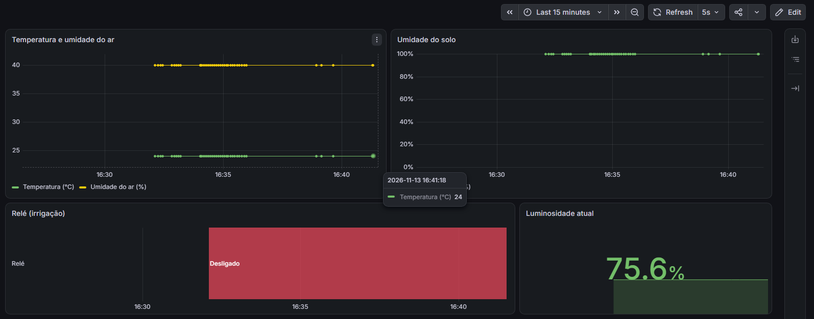
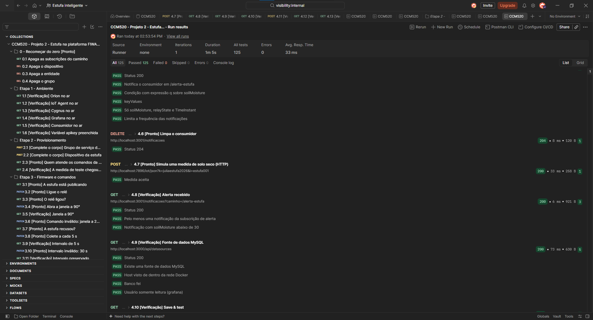

# Estufa inteligente na plataforma FIWARE — Grupo `juliaestufa2026`

Projeto 2 da disciplina CCM520 – Internet das Coisas (Centro Universitário FEI).

**Integrantes:** Júlia Bastos Barreto (RA 22124071)
**Link do Wokwi:** <https://wokwi.com/projects/480441833814043649>

## 1. Descrição

A estufa é uma ESP32 em MicroPython, simulada no Wokwi, que monitora a temperatura e a umidade do ar (DHT22), a umidade do solo e a luminosidade, e aciona um relé de irrigação e um servomotor que abre a janela. Ela publica as medidas no broker MQTT público da HiveMQ, e uma ponte traz essas mensagens para a plataforma FIWARE no computador do grupo. Lá, o IoT Agent JSON transforma a estufa na entidade `urn:ngsi-ld:Greenhouse:001` do Orion. A partir daí, qualquer aplicação consulta o estado e envia comandos pelo Orion (NGSI-v2), sem usar MQTT. Subscrições do Orion alimentam o histórico (Cygnus → MySQL → Grafana) e um alerta de solo seco para um serviço externo.

## 2. Arquitetura

```
  INTERNET                          |  COMPUTADOR DO GRUPO (Docker)
                                    |
  ESP32 / Wokwi                     |
     ^   |  MQTT :1883              |
     |   v                          |
  broker.hivemq.com  <== ponte ==>  |  Mosquitto :1883
  (público)       (só os tópicos    |     ^   |  MQTT :1883
                   da API key)      |     |   v
                                    |  IoT Agent JSON :4041 / :7896  <-- HTTP :4041 -- Postman
                                    |     ^   |  HTTP NGSI-v2 :1026                    (provisionamento)
                                    |     |   v
                                    |  Orion :1026 (+ MongoDB :27017) <-- HTTP :1026 -- Postman
                                    |     |                    |                      (comandos e consultas)
                                    |     | HTTP :3000         | HTTP :5050
                                    |     | keyValues          | normalized
                                    |     v                    v
                                    |  Consumidor           Cygnus --SQL :3306--> MySQL :3306
                                    |  (:3001 no PC)                                 |
                                    |                                      SQL :3306 v
                                    |                                     Grafana :3000
```

- **Norte (medidas):** ESP32 → HiveMQ → ponte → Mosquitto → IoT Agent → Orion → subscrições.
- **Sul (comandos):** Postman → Orion → IoT Agent → Mosquitto → ponte → HiveMQ → ESP32.

## 3. Hardware

| Componente | Pino da ESP32 | Observação |
| --- | --- | --- |
| DHT22 | `GPIO4` | temperatura e umidade do ar |
| Umidade do solo | `GPIO34` | ADC, atenuação 11 dB (0 a 4095) |
| LDR | `GPIO35` | ADC, atenuação 11 dB (0 a 4095) |
| Relé | `GPIO26` | saída digital (irrigação) |
| Servomotor | `GPIO27` | PWM 50 Hz (janela, 0° a 180°) |

**Calibração:** os sensores de solo e de luz são lidos pelo ADC de 12 bits (0 a 4095). No circuito do Wokwi, uma leitura menor corresponde a solo mais úmido e a mais luz, então a conversão é invertida e linear: `% = 100 × (4095 − leitura) / (4095 − 0)`, limitada entre 0 e 100. Valores de referência usados: leitura **4095 = 0 %** (solo seco / escuro) e leitura **0 = 100 %** (solo encharcado / claro). As constantes ficam em `ADC_SECO_ESCURO` e `ADC_MOLHADO_CLARO` no firmware; com sensores reais, elas precisam ser medidas de novo.

## 4. Identificadores

| Item | Valor |
| --- | --- |
| API key | `juliaestufa2026` |
| Client id da ponte | `ponte_juliaestufa2026` |
| `fiware-service` / `fiware-servicepath` | `fei` / `/estufa` |
| `device_id` | `estufa001` |
| Entidade | `urn:ngsi-ld:Greenhouse:001` (`Greenhouse`) |
| Client id MQTT da ESP32 | `esp32_juliaestufa2026_estufa001` |

## 5. Modelo de dados

### 5.1 Medidas

| `object_id` (firmware) | Atributo NGSI | Tipo | Unidade / faixa |
| --- | --- | --- | --- |
| `t` | `temperature` | Number | °C |
| `h` | `relativeHumidity` | Number | % |
| `s` | `soilMoisture` | Number | % |
| `l` | `illuminance` | Number | % |
| `r` | `relayState` | Number | 0/1 |
| `a` | `windowAngle` | Number | 0–180 |
| `i` | `samplingInterval` | Number | s |

Exemplo de payload publicado: `{"i": 3, "l": 75.6, "t": 24.0, "a": 0, "h": 40.0, "s": 100, "r": 0}`

### 5.2 Comandos

| Comando | Valores aceitos | Resposta de sucesso | Respostas de erro |
| --- | --- | --- | --- |
| `setRelay` | `0` ou `1` | `OK` | `ERRO: setRelay aceita 0 ou 1`, `ERRO: valor invalido` |
| `setServo` | `0` a `180` | `OK` | `ERRO: setServo aceita 0 a 180`, `ERRO: valor invalido` |
| `setInterval` | `2` a `10` (segundos) | `OK` | `ERRO: setInterval aceita 2 a 10 segundos`, `ERRO: valor invalido` |
| `setSending` | `1` (ativa) ou `0` (desativa) | `OK` | `ERRO: setSending aceita 0 ou 1`, `ERRO: valor invalido` |

### 5.3 Tópicos MQTT

| Sentido | Tópico |
| --- | --- |
| Medidas | `/json/juliaestufa2026/estufa001/attrs` |
| Comandos | `/juliaestufa2026/estufa001/cmd` |
| Resultado | `/json/juliaestufa2026/estufa001/cmdexe` |

### 5.4 Ponte com o broker público

| Padrão | Direção | Por quê |
| --- | --- | --- |
| `/json/juliaestufa2026/estufa001/attrs` | `in` | medidas que a estufa publica no HiveMQ precisam chegar ao IoT Agent local |
| `/json/juliaestufa2026/estufa001/cmdexe` | `in` | resultado (`OK`/`ERRO`) dos comandos executados pela estufa volta ao IoT Agent |
| `/juliaestufa2026/estufa001/cmd` | `out` | comandos que o IoT Agent publica localmente precisam chegar à ESP32 pelo HiveMQ |

## 6. Como reproduzir

**Pré-requisitos:** Docker Desktop (com a virtualização ligada na BIOS), Postman, um navegador e as portas 1026, 27017, 4041, 7896, 1883, 3000, 3001, 3306, 5050 e 5080 livres.

1. **Clone o repositório e entre na pasta da plataforma.**
   ```bash
   git clone https://github.com/julbastos/Estufa-inteligente.git
   cd Estufa-inteligente/plataforma
   ```
2. **Confira a ponte.** `mosquitto/mosquitto.conf` já está com a API key `juliaestufa2026` no `remote_clientid` e nas três linhas `topic`. Não é preciso alterar nada.
3. **Suba o ambiente.**
   ```bash
   docker compose up -d
   docker compose ps
   docker compose logs mosquitto
   ```
   ✔ Os 9 contêineres aparecem como `healthy`, e o log do Mosquitto mostra `Connecting bridge hivemq (broker.hivemq.com:1883)` uma única vez.
4. **Teste a ponte.** Em um terminal, deixe rodando `docker exec -it mosquitto mosquitto_sub -v -t "#"`. No [HiveMQ WebSocket Client](https://www.hivemq.com/demos/websocket-client/), publique `oi` em `/json/juliaestufa2026/estufa001/attrs`.
   ✔ A mensagem aparece no terminal local. Publicada com outra API key, ela **não** aparece.
5. **Ligue a estufa.** Abra o [projeto no Wokwi](https://wokwi.com/projects/480441833814043649) e clique em ▶. Deixe a janela do Wokwi **visível** (em segundo plano o navegador desacelera a simulação).
   ✔ O console mostra `Wi-Fi ok`, `MQTT conectado` e uma linha `medidas -> {...}` a cada 3 s. (Na placa real, grave `firmware/main_esqueleto.py` como `main.py` e preencha `SSID`/`SENHA`.)
6. **Importe a coleção** `postman/Projeto 2.postman_collection.json` no Postman e confira, na aba *Variables*, que `apikey` = `juliaestufa2026`.
7. **Rode as etapas, na ordem:**
   - **Etapa 1** (1.1 a 1.6): ✔ todos os serviços respondem.
   - **Etapa 2**: envie 2.1 (grupo) e 2.2 (dispositivo) e rode 2.3. Publique no HiveMQ Web Client `{"t": 25.5, "h": 55}` em `/json/juliaestufa2026/estufa001/attrs` e rode 2.4. ✔ A medida aparece no Orion.
   - **Etapa 3** (3.1 a 3.15, sem pular): ✔ relé, janela, intervalo e envio obedecem; os valores inválidos voltam `ERRO` sem mudar o estado.
   - **Etapa 4**: envie 4.1 **uma vez só** e rode 4.2 e 4.3; envie 4.4 **uma vez só** e rode 4.5 a 4.8. ✔ Histórico chegando no Cygnus e alerta no consumidor (<http://localhost:3001/notificacoes?caminho=/alerta-estufa>).
8. **Grafana** (<http://localhost:3000>, `admin` / `admin`):
   - *Connections → Data sources → Add data source → MySQL*: Host URL `mysql-db:3306`, banco `fei`, usuário `grafana`, senha `grafana2026` → **Save & test**. ✔ "Database Connection OK".
   - *Dashboards → New → Import*: envie `plataforma/painel-estufa.json` e escolha a fonte MySQL criada.
   - Rode 4.9 a 4.13 no Postman. ✔ Todos passam.
9. **Coleção inteira:** no Postman, *Run collection* (Delay 0), com o Wokwi ligado e visível. ✔ 125 testes aprovados.

**Se as medidas pararem de chegar ao Orion** (mas continuarem aparecendo no HiveMQ Web Client), a ponte travou: rode `docker compose restart mosquitto` na pasta `plataforma`.

**Para recomeçar:** a pasta *0 - Recomeçar do zero* da coleção apaga provisionamento e subscrições. `docker compose down -v` apaga tudo, inclusive o histórico e o painel.

## 7. Subscrições

| Subscrição | Condição | Destino | Atributos e formato | Por que assim |
| --- | --- | --- | --- | --- |
| Histórico | qualquer mudança nas entidades do tipo `Greenhouse` (`idPattern: ".*"`) do caminho `/estufa` | `http://cygnus:5050/notify` | os 7 atributos de medida, `normalized` | o Cygnus só aceita `normalized`; quem notifica é o Orion, de dentro da rede Docker, por isso o nome do serviço e não `localhost` |
| Alerta de solo seco | `soilMoisture` mudou e `q: soilMoisture<30` | `http://consumidor:3000/alerta-estufa` | `soilMoisture`, `relayState`, `TimeInstant`, `keyValues` | o consumidor só precisa dos valores; `throttling: 60` evita uma notificação a cada medida enquanto o solo estiver seco |

## 8. Painel



O JSON exportado está em `plataforma/painel-estufa.json`. Todas as consultas leem a tabela `estufa` (uma linha por atributo gravada pelo Cygnus), convertem o texto com `CAST` e usam `$__timeFilter(recvTime)`; a atualização automática é de 5 s.

| Visualização | Tipo | Consulta | O que mostra |
| --- | --- | --- | --- |
| Temperatura e umidade do ar | Time series | duas consultas, `attrName = 'temperature'` e `attrName = 'relativeHumidity'` | a evolução de °C e % do ar no mesmo gráfico |
| Umidade do solo | Time series | `attrName = 'soilMoisture'` | a evolução da umidade do solo (0 a 100 %) |
| Relé (irrigação) | State timeline | `attrName = 'relayState'`, com `CAST(... AS SIGNED)` | quando o relé esteve Ligado (verde) e Desligado (vermelho) |
| Luminosidade atual | Stat | `attrName = 'illuminance'`, cálculo *Last* | o último valor de luminosidade |

## 9. Testes



- **Runner do Postman:** coleção inteira, começando pela pasta *0 - Recomeçar do zero*, com a estufa ligada no Wokwi: **125 testes aprovados, 0 falhas** (`postman/runner.png`).
- **Arquivo de resultados:** o Postman passou a exigir plano pago para exportar o resultado do Runner, então a mesma coleção foi executada com o [Newman](https://github.com/postmanlabs/newman) (executor de linha de comando do Postman): **125 aprovados, 0 falhas**, em `postman/Projeto 2.newman-resultados.json`.
- **Robustez:** mensagens que não são JSON válido no tópico de comandos são ignoradas pelo firmware (`Mensagem ignorada: JSON invalido`), sem derrubar o programa.

## 10. Decisões de projeto e limitações

**Decisões**
- `object_id` de uma letra, para manter curto o JSON publicado pela ESP32.
- Intervalo padrão de 3 s, alterável por `setInterval` entre 2 e 10 s.
- Todo comando responde `OK` ou `ERRO: <motivo>`, e um valor inválido nunca muda o estado. Depois de um comando, a estufa publica uma medida na hora, para o Orion e o painel refletirem o novo estado.
- Laço principal não bloqueante (`check_msg()` + `ticks_ms`), sem `time.sleep()` nem `wait_msg()`.
- Reconexão automática de Wi-Fi e MQTT (D.2) e tempo limite de 30 s para a primeira conexão Wi-Fi, que no Wokwi às vezes passa de 15 s.
- Grupo de serviço com `autoprovision: false`, para rejeitar dispositivos não provisionados.
- Grafana acessando o MySQL com o usuário `grafana`, somente leitura.

**Limitações**
- A ponte do Mosquitto às vezes trava depois que o Docker fica alguns instantes sem responder: as medidas chegam ao HiveMQ, mas não ao Orion. Solução: `docker compose restart mosquitto`.
- Com a aba do Wokwi em segundo plano, a simulação fica lenta e os testes sensíveis a tempo (3.15 e 4.2) falham.
- A calibração usa os extremos do ADC da simulação; com sensores reais, seria preciso medi-los.
- O broker público não tem autenticação nem controle de acesso: qualquer pessoa pode ler os tópicos, publicar comandos ou derrubar a conexão da estufa usando o mesmo client id. Em um sistema real, usaríamos um broker privado com autenticação (e controle de acesso por tópico e TLS).

## 11. Desafios realizados

| Desafio | Situação | Onde |
| --- | --- | --- |
| D.1 · Automação em malha fechada | não realizado | – |
| D.2 · Reconexão | **realizado** | `firmware/main_esqueleto.py`, seções 6 e 7: ao detectar `OSError` (ou Wi-Fi desconectado), descarta o cliente, tenta reconectar a cada 5 s e assina de novo o tópico de comandos |
| D.3 · TLS | não realizado | – |
| D.4 · Segunda estufa | não realizado | – |

## 12. Uso de ferramentas de IA

Foi usado um assistente de IA para: diagnosticar problemas do ambiente (virtualização desligada na BIOS, limite de downloads do Docker Hub, ponte do Mosquitto travada e lentidão do Wokwi); revisar os corpos JSON da coleção feitos por mim; gerar o resultado da coleção com o Newman, já que a opção pedida exigia uma assinatura paga; e apoiar a escrita deste README e das seções 1 a 5 do relatório. As respostas R1 a R8 do relatório foram escritas por mim, com revisão do assistente.

## 13. Referências

- Material das Aulas 5 a 9 da disciplina CCM520 e guia passo a passo do Projeto 2 (`documentacao apoio/`).
- FIWARE IoT Agent JSON: <https://fiware-iotagent-json.readthedocs.io>
- FIWARE Orion (NGSI-v2): <https://fiware-orion.readthedocs.io>
- FIWARE Cygnus: <https://fiware-cygnus.readthedocs.io>
- HiveMQ MQTT Essentials: <https://www.hivemq.com/mqtt/>
- Grafana, fonte de dados MySQL: <https://grafana.com/docs/grafana/latest/datasources/mysql/>
- Newman: <https://github.com/postmanlabs/newman>
